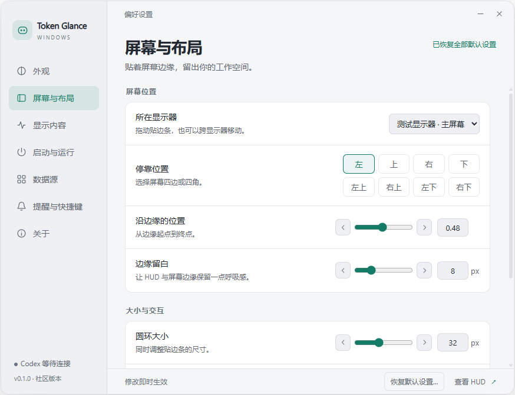

# Token Glance

一个安静的 Windows AI 用量助手，让额度待在视线边缘。

**v0.1.1 · 实验性源码预览 · Windows 专用 · MIT**

独立社区项目，非 OpenAI、Anthropic、DeepSeek 或参考项目的官方发行版。

[v0.1.1 实验性预览发布页](https://github.com/bin19870223-netizen/token-glance/releases/tag/v0.1.1) · 本版提供源码，不是免安装 exe。



上图是隔离测试环境中的设置页，不包含真实账号或会话数据。

## 能做什么

- 贴边圆环显示剩余额度；悬停查看详情，点击固定，右键打开设置。
- 拖动吸附四边、跨显示器移动；直接选择四边或四角，避开任务栏。
- Codex 账号额度、重置倒计时、7 / 30 天按日 Token 活动、累计 Token、最近会话跳转。
- 深色、浅色、系统主题，多套配色，透明度、尺寸、文字大小、动画、置顶和快捷键。
- 所有设置滑条支持箭头微调、数字输入后 Enter 保存、Esc 取消输入。
- 「恢复默认设置…」可选择仅恢复本页或恢复全部；执行前说明范围。
- 手动启动、随 Windows 登录启动、随监控 Agent 启动；跟随模式使用小型 .NET 监听器每五秒检查进程。
- 普通应用上方保持置顶；Windows 报告独占全屏 Direct3D 游戏时自动暂停置顶，返回桌面恢复。

## 支持范围

| 数据源 | 当前能力 | 边界 |
| --- | --- | --- |
| Codex | 本机 app-server 返回的账号额度、Token 和会话列表 | 使用实验性接口；字段与可用性随 Codex 版本变化 |
| Claude / DeepSeek | 用户选择的本地 JSON 快照 | 尚无实时账号连接 |

没有返回的数据显示「—」，不生成演示读数。不把账号 Token 与订阅额度互相换算；日数据可能延迟，额度周期按接口实际返回标注。任务运行/完成/审批状态、逐会话 Token 分项尚未接入。

## 从源码运行

需要 Windows 10/11、Node.js **22.12+**、npm，以及 Windows .NET Framework 4.x 的 C# 编译器。建议把项目放在可写目录；不要放在 `Program Files` 等需要管理员权限的目录。

```powershell
npm ci
npm run build:watcher
npm start
```

也可在完成安装和构建后双击 `START.vbs`，静默启动 Electron。无需管理员权限，不修改 Codex 客户端、不注册审批 hooks。目前提供源码，**没有安装包、代码签名或自动升级器**。

Codex 必须由用户自行安装并登录。本工具依次检查 `AGENT_HUD_CODEX` 指定的 exe、本机 `%LOCALAPPDATA%\OpenAI\Codex\bin`、PATH 中的 `codex.exe`；环境变量名称保留历史兼容性。例如：

```powershell
$env:AGENT_HUD_CODEX = 'D:\Tools\codex.exe'
npm start
```

没有可用接口时保持离线显示，不会替用户登录。会话跳转还需要本机注册 `codex://` 协议。

## 启动方式

在「启动与运行」选择仅手动、随 Windows 或随监控 Agent 启动。跟随模式仅监听「数据源」中启用的 Agent；所有监控对象退出后关闭界面与用量连接。Codex 自己的 app-server 被排除，避免本工具让自己无法退出。

可配置 exe 文件名，多个名称用逗号分隔。Claude Code 的 Node 版本按专用脚本路径识别。启动项使用历史内部标识 `AgentHUD.Windows`；改变显示名称不会额外创建启动项。复制或移动项目后，需要重新选择启动方式，以更新启动路径。重编译正在运行的监听器之前，先切换为仅手动启动并等待它退出。

关闭设置页不会退出常驻工具；使用托盘菜单或「关于 → 退出 Token Glance」。

## 本地数据与隐私

设置、聚合用量、数据源路径和 Electron 缓存保存在项目目录下的 `runtime/`。它们不属于源码，已被 Git 忽略和源码导出工具排除。会话标题、ID 仅留在内存；不写入聚合用量缓存。

本工具不直接读取或保存密码、Cookie、API Key。它启动官方 Codex app-server，复用该程序管理的现有登录；该子进程仍遵循 Codex 自己的网络与账号行为。项目没有自己的遥测服务器。完整边界见 [隐私与安全说明](docs/privacy.md)。

Claude / DeepSeek 快照格式见 [examples/usage-snapshot.json](examples/usage-snapshot.json)。其中全部数字是明确的格式示例，程序默认不会加载。文件最大 1 MiB，五分钟后标为旧数据。

## 开发

```powershell
npm test                  # 数据、布局、设置与 IPC 重置逻辑
npm run test:watcher       # 编译并运行进程识别测试
npm run test:ui            # 隔离的 Electron 界面检查，无账号读取
npm run test:topmost       # Windows 原生窗口层级检查，先构建，在普通桌面运行
npm audit --registry=https://registry.npmjs.org
```

运行数据和测试产物应留在 `runtime/`、`work/`，不要提交。目录说明、资源测量和源码导出见 [开发说明](docs/development.md)。欢迎贡献，先阅读 [CONTRIBUTING.md](CONTRIBUTING.md)。

## 许可与致谢

项目代码按 [MIT](LICENSE) 提供。交互参考 [Agent HUD Open](https://github.com/jazzenchen/agent-hud-open)，设置布局参考 [session-model-usage](https://github.com/CyclicRedundancyCHK/session-model-usage)。这是独立的 Electron / C# 实现，未打包参考项目源码或安装器。

提供商标志来自 LobeHub 的 Lobe Icons，保留原 MIT 许可证。标志用于识别对应服务，不代表官方支持或背书。来源、版本与许可见 [THIRD_PARTY_NOTICES.md](THIRD_PARTY_NOTICES.md)。
