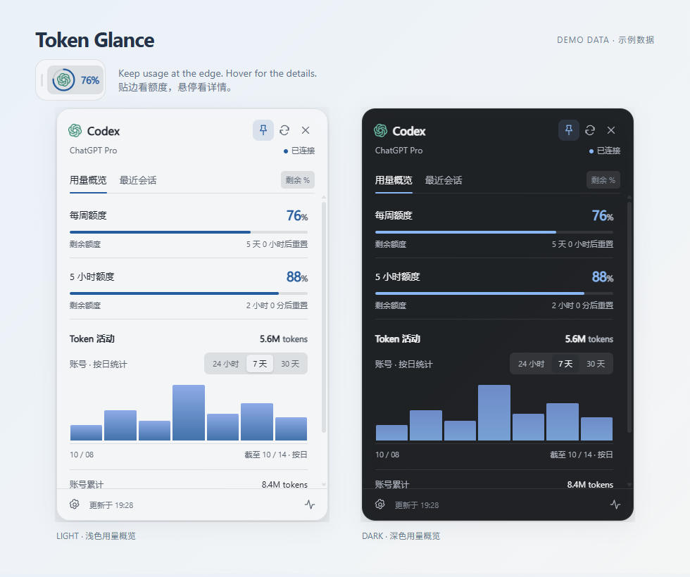
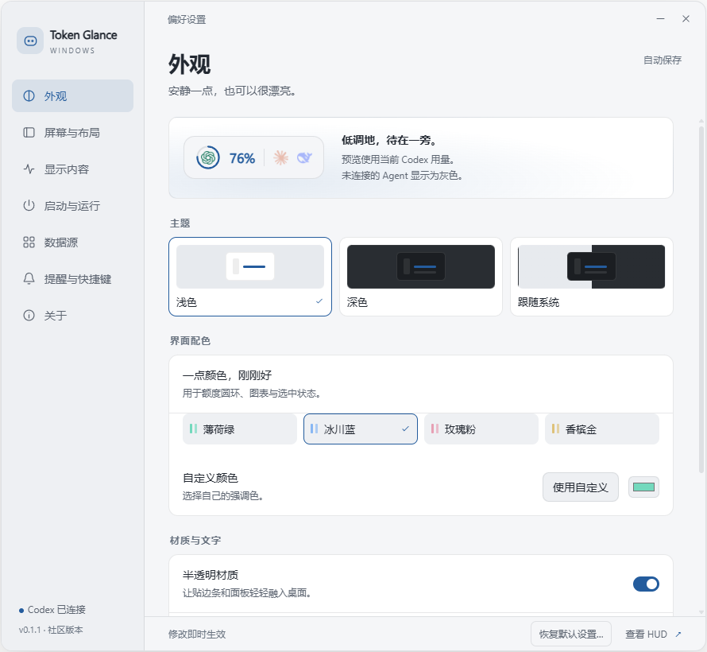
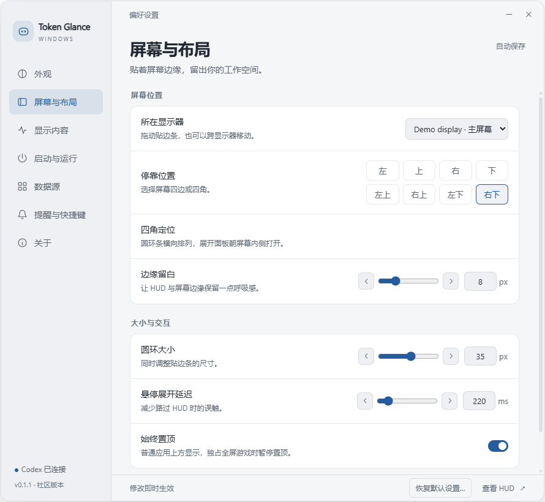
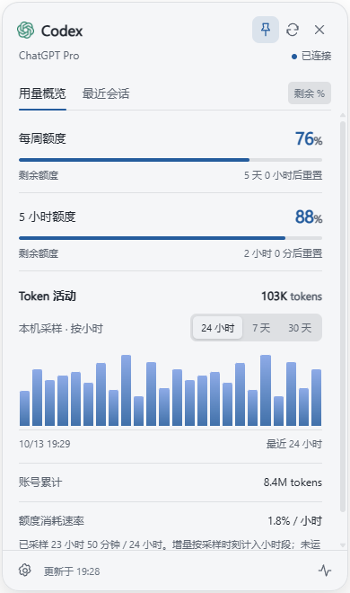
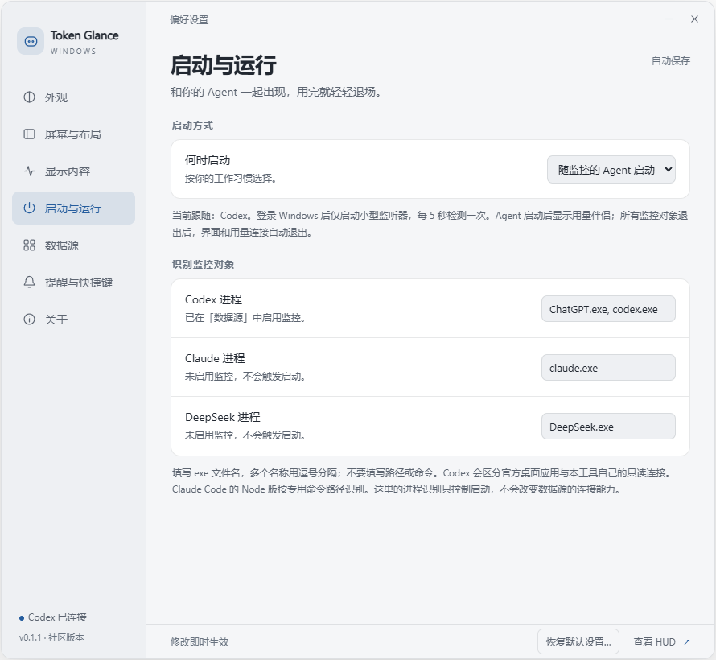
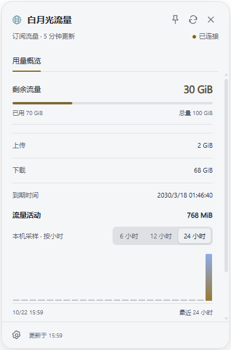
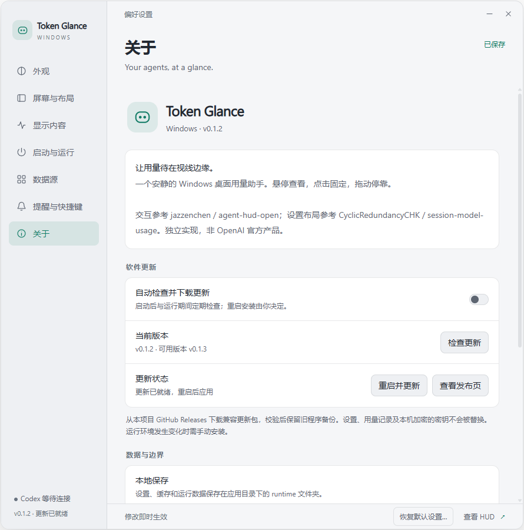

# Token Glance

[简体中文](README.md) · [English](README.en.md)

**一个安静的 Windows AI 用量助手，让额度待在视线边缘。**

平时是一枚贴边圆环，悬停展开额度和 Token 活动，点击即可固定面板。需要时看一眼，用完继续工作。

Windows 10 / 11 · MIT · **v0.1.4 实验性源码预览**

[获取源码](https://github.com/bin19870223-netizen/token-glance/releases/tag/v0.1.4) · [更新记录](CHANGELOG.md) · [反馈问题](https://github.com/bin19870223-netizen/token-glance/issues)



> 图片直接截取自当前程序的隔离演示环境，使用示例额度和 Token 数据，不包含真实账号或会话。应用目前使用简体中文界面。

## 一眼能看到什么

- **剩余额度**：贴边圆环、百分比、短周期 / 每周额度，以及重置倒计时。
- **Token 活动**：最近 24 小时的本机采样、7 / 30 天的账号按日汇总，以及账号累计 Token。
- **最近会话**：查看最近会话，点击回到 Codex；会话标题和 ID 仅保留在内存。
- **随手操作**：悬停展开、点击固定、右键设置、拖动停靠，支持快捷键。

## 按你的桌面习惯设置

浅色、深色或跟随系统；多套配色、自定义颜色、透明度、字号和圆环大小。可选择四边、四角及显示器。所有滑条支持箭头微调和数字输入，恢复默认时可选择仅本页或全部设置。

| 外观与配色 | 屏幕位置与布局 |
| --- | --- |
| [](docs/images/settings-appearance.png) | [](docs/images/settings-layout.png) |

点击图片可查看大图。

## 24 小时活动与启动方式

24 小时视图按小时展示**工具运行期间观测到的累计增量**（接口延迟补报会集中在读到的小时，无法还原实际发生时间），从更新后开始累计。未运行、断线和重启间隔保留为无数据，不会用按日账单补造小时明细。7 / 30 天仍使用账号的按日汇总。

支持手动启动、随 Windows 登录启动、随监控 Agent 启动。“随 Windows 启动”只在登录时触发；希望关闭并重新打开 Codex 后再次显示，请选择“随监控的 Agent 启动”。跟随模式每五秒检查已启用的 Agent；所有监控对象退出后，界面及其用量连接自动退出，独立监听器保留，等待下次启动。

| 最近 24 小时 · 本机采样 | 随 Agent 启动 |
| --- | --- |
| [](docs/images/activity-24h.png) | [](docs/images/settings-startup.png) |

HUD 被普通应用遮挡时恢复置顶，不抢键盘焦点；Windows 报告 Direct3D 独占全屏时暂停置顶，返回桌面后恢复原来的选择。真实独占游戏及其他图形 API / 全屏优化组合仍待实测。

## 支持哪些数据源

新增白月光机场流量：在「设置 → 数据源 → 机场流量 · 白月光」填写本站原始 Clash / Mihomo HTTPS 订阅链接，点击「保存并连接」。验证成功后，现有贴边条新增流量圆环，悬停可看剩余、已用、总量、上传/下载和到期时间；每 5 分钟刷新。需要订阅返回 `Subscription-Userinfo` 响应头，未提供的信息不猜测补齐。链接仅在本机加密保存，请勿放入公开仓库或聊天。

| 数据源 | 当前能力 | 边界 |
| --- | --- | --- |
| Codex | 本机官方 app-server 返回的额度、Token 和最近会话 | 使用实验性接口，字段与可用性可能变化 |
| DeepSeek | 官方 API 可用、充值与赠送余额；保留本地快照适配器 | 余额接口不提供 Token 消耗明细 |
| 白月光流量 | 套餐剩余、已用、到期时间及 6 / 12 / 24 小时采样图 | 历史按本机采样积累，不能倒推启用前的用量 |
| Claude | 用户选择的本地 JSON 用量快照 | 尚无实时账号连接 |

没有返回的数据显示「—」。Token 与订阅额度分别统计，不能互相换算；按日数据可能延迟。目前尚未接入实时审批、任务运行状态和逐会话 Token 分项。

## 新增的数据源与更新界面

| 机场流量 · 按小时采样 | 应用内更新 · 隔离演示 |
| --- | --- |
|  |  |

以上均为隔离测试数据；更新图中的候选版本仅用于演示流程。

## 从源码运行

需要 Windows 10 / 11、Node.js **22.12+**、npm 和 Windows .NET Framework 4.x 的 C# 编译器。将源码放在可写目录，运行：

```powershell
npm ci
npm run build:watcher
npm start
```

构建命令同时生成 Agent 启动监听器和全屏 / 遮挡检测程序。完成安装和构建后，也可双击 `START.vbs` 静默启动。

**当前发布的是源码和应用内更新包，没有签名安装包或免安装 exe。首次使用需按上述步骤安装运行环境，之后可在「关于 → 软件更新」更新兼容版本。** Codex 需自行安装并登录。工具会检查本机安装路径和 PATH 中的 `codex.exe`；自定义路径可通过历史兼容变量指定：

```powershell
$env:AGENT_HUD_CODEX = 'D:\Tools\codex.exe'
npm start
```

关闭设置页不会退出工具；使用托盘菜单或「关于 → 退出 Token Glance」。升级或重新构建前先退出工具；Agent 跟随模式需先切换为仅手动启动并等待监听器退出。移动源码目录后重新选择启动方式，以更新启动路径。

## 隐私与项目边界

设置、聚合用量、数字采样、账号标识摘要和缓存保存在本机 `runtime/`，不属于公开源码。工具不读取浏览器 Cookie、密码或其他软件的 API Key，也没有自己的遥测服务器。手动填写的 DeepSeek API Key 和机场订阅链接由 Windows 本机加密保存，不写入日志或公开源码。它通过官方 Codex app-server 复用该程序管理的现有登录，仅调用允许的只读接口。

这是独立社区项目，非 OpenAI、Anthropic、DeepSeek 或参考项目的官方发行版。工具不会发起模型任务、替你批准操作或消耗重置券。

[隐私与安全说明](docs/privacy.md) · [验证范围](docs/validation.md) · [快照格式示例](examples/usage-snapshot.json)

## 开发与贡献

```powershell
npm test
npm run test:watcher
npm run test:ui
npm run test:topmost
```

原生窗口测试需先构建，并在普通 Windows 桌面运行。开发、资源测量和干净源码导出见 [开发说明](docs/development.md)；贡献前请阅读 [CONTRIBUTING.md](CONTRIBUTING.md)。运行数据、日志和测试产物不要提交。

## 许可与致谢

项目代码按 [MIT](LICENSE) 提供。交互参考 [Agent HUD Open](https://github.com/jazzenchen/agent-hud-open)，设置布局参考 [session-model-usage](https://github.com/CyclicRedundancyCHK/session-model-usage)。本项目为独立 Electron / C# 实现。

提供商标志来自 LobeHub 的 Lobe Icons，仅用于识别服务，不代表官方支持或背书。来源及保留的许可证见 [THIRD_PARTY_NOTICES.md](THIRD_PARTY_NOTICES.md)。


DeepSeek 官方 API 余额：在「设置 → 数据源 → DeepSeek · 官方 API 余额」填写 API Key，点击「保存并连接」。密钥仅在本机 Windows 加密保存；每 5 分钟查询可用、充值与赠送余额。余额接口不提供 Token 消耗明细，界面不会据此推算百分比或 Token 数。

机场流量明细支持最近 6 / 12 / 24 小时用量。每 5 分钟采样订阅累计流量，显示上传与下载合计增量及实际采样时长；从启用后积累，不补造历史或离线时段数据。最近 24 小时记录仅保存在本机。


自动更新位于「设置 → 关于 → 软件更新」。默认启动后及每 6 小时检查本仓库 GitHub Releases（含实验性预发布），自动下载兼容包；点击「重启并更新」后安装，设置、用量和加密密钥保持在原 runtime 目录。运行环境改变或发布仅有源码时，通过发布页手动升级。更新失败会尝试恢复旧程序；旧程序备份位于 runtime/updates。

维护者发布：先同步源码与版本号，再发布与 package.json 对应的 vX.Y.Z Release；release-update 工作流完成测试后上传 token-glance-update.json 附件。也可用 npm run build:update 本地生成附件。首个包含更新器的版本仍需手动升级，之后才能使用应用内更新。这里只信任本仓库的公开发布附件和 GitHub 返回的 SHA-256，不提供独立代码签名验证。

机场流量告警在「提醒与快捷键」中启用：30 分钟观测增量达到 20 GiB、套餐已用达到 80% / 95% 时记录并提醒。魔兽世界处于前台、全屏窗口或系统不接受通知时先静默保存，返回桌面后合并成无声系统通知。告警不会打开应用窗口或切换焦点；告警记录仅存本机，Token Glance 退出时监控停止。

### 升级到 v0.1.4

本版更新原生游戏静默检测程序。从公开 v0.1.3 升级时请下载源码包，退出 Token Glance 与监听器，保留 runtime 中的设置、采样和加密密钥，覆盖源码后运行 npm ci、npm run build:watcher 再启动。原生检测程序已经匹配的安装可以使用应用内更新。旧的独立计划任务不会由软件自动停用，已有旧任务的用户需自行确认后停用，避免重复监控。

显示器选择现在同时记住屏幕名称和布局；副屏暂未就绪时保留目标，连接后自动恢复。设置同步保存到主文件和有效备份；中断时恢复最新有效记录，不能恢复时保留文件并退出，不用默认值覆盖。

旧版只保存数字屏幕 ID：首次升级后请在「屏幕与布局」确认一次目标屏幕，之后会同时记住名称和布局。

本版同时升级 Electron 至 44.10.1 并修复下载依赖的安全问题，因此旧版需要更新 Node 依赖，不能只覆盖 src。
